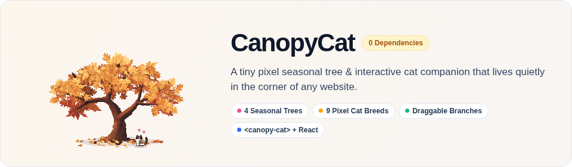
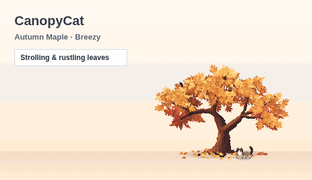
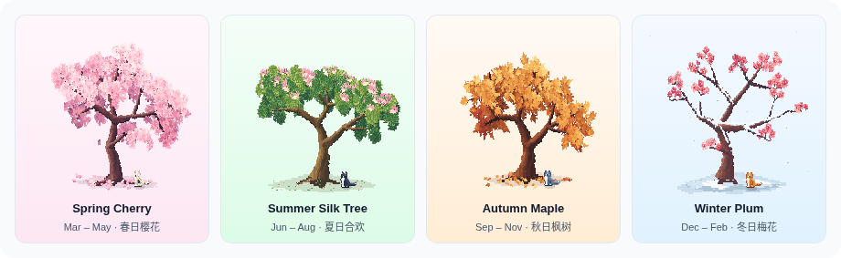
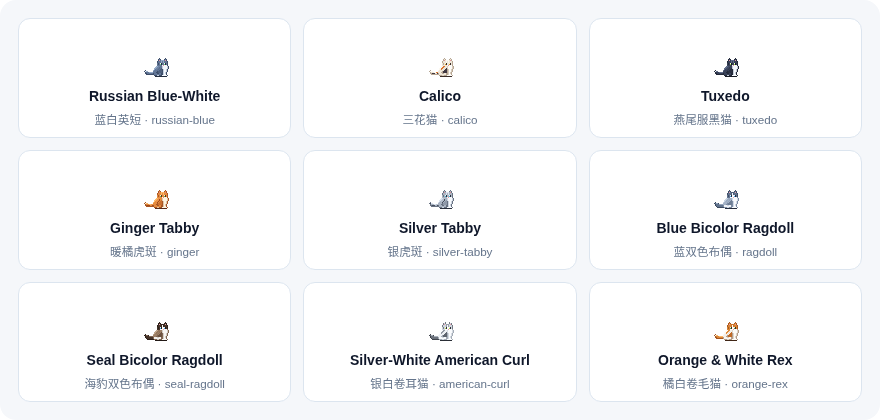

<div align="center">



<p>
  <strong>English</strong> · <a href="./README.zh-CN.md">简体中文</a>
</p>

<p>
  <a href="https://liuxsh9.github.io/canopy-cat/">
    
  </a>
  <a href="https://github.com/liuxsh9/canopy-cat/releases">
    
  </a>
  
  
  <a href="./LICENSE">
    
  </a>
</p>

<p>
  A tiny, zero-dependency pixel seasonal tree &amp; interactive cat companion that lives quietly in the corner of any website.<br />
  Drop one <code>&lt;canopy-cat&gt;</code> tag into your blog, docs site, portfolio, or web app.
</p>



<br />
<sub><em>Click the cat to pet · Drag branches to shake leaves · Click the tree to customize seasons, breeds &amp; weather</em></sub>

</div>

---

## Highlights

- **Zero runtime dependencies** — pure HTML5 Canvas & procedural pixel art (~35 kB gzipped).
- **4 hand-crafted seasonal trees** — switch freely between Spring Cherry, Summer Silk, Autumn Maple, and Winter Plum, each with bespoke foliage, petals, blooms, or snowfall.
- **8 hand-crafted pixel cat breeds** — 24 animation frames (`30×26` px), freely combinable with any tree, plus `cat="auto"` for high-contrast seasonal pairing.
- **Quietly alive, never distracting** — tuned for always-on websites (~88% calm resting/napping/loafing, cooldown-gated actions, paused automatically when off-screen or when `prefers-reduced-motion` is enabled).
- **Delightful micro-interactions**:
  - **Pet the cat** — click the cat for floating pixel hearts (`♥`) and happy purr frames.
  - **Grab & drag branches** — spring-physics branch swaying with cascading leaves; wakes a sleeping cat (`!`) or entices an awake cat to climb toward the branch.
  - **Storm shelter** — switch to Storm weather and watch the cat stroll off-screen to shelter, then wander back once the wind calms down.
  - **Everyday cat habits** — 4-frame paw-lick & face-wipe grooming, trunk scratching with flying bark chips & trunk shiver, chasing falling leaves, and three-tier paw-rustle leaf physics.
- **Works everywhere** — Shadow DOM `<canopy-cat>` Web Component (zero CSS leakage), Vanilla JS/TS API, and optional React wrapper (`canopy-cat/react`).

---

## Four Seasonal Trees

<div align="center">
  
</div>

| Key | Tree | Auto-Paired Cat | Signature Detail |
| --- | --- | --- | --- |
| `cherry` | Spring Cherry | Calico | Drifting pink cherry petals |
| `silk` | Summer Silk Tree | Tuxedo | Floating silky pink-white blooms |
| `maple` | Autumn Maple *(default)* | Russian Blue-White | Multi-tone crimson & gold falling leaves |
| `plum` | Winter Plum | Ginger Tabby | Snowfall & layered branch snow under perched cats |

---

## Eight Cat Breeds

<div align="center">
  
</div>

Use `cat="auto"` (default) to pair a complementary breed with each tree, `cat="none"` to show only the tree, or pick any breed directly:
`russian-blue` · `calico` · `tuxedo` · `ginger` · `silver-tabby` · `ragdoll` · `american-curl` · `orange-rex`.

---

## Quick Start

### 1. HTML / Web Component (One Line — Blogs, Docs, Static Sites)

```html
<script type="module" src="https://liuxsh9.github.io/canopy-cat/canopy-cat.js"></script>
<canopy-cat tree="maple" cat="auto" weather="breezy"></canopy-cat>
```

### 2. Vanilla JS / TypeScript (Vue, Svelte, Astro, VitePress, etc.)

```bash
npm install https://github.com/liuxsh9/canopy-cat/releases/latest/download/canopy-cat.tgz
```

```js
import { mountCanopyCat } from 'canopy-cat';

const companion = mountCanopyCat(document.body, {
  tree: 'maple',     // 'cherry' | 'silk' | 'maple' | 'plum'
  cat: 'auto',       // 'auto' | 'none' | breed key
  weather: 'breezy', // 'calm' | 'breezy' | 'storm'
  position: 'bottom-right',
  persist: true,     // remember visitor's customizations in localStorage
});

// Optional programmatic triggers:
companion.triggerAction('pet');     // 'pet' | 'scratch' | 'climb' | 'groom' | 'nap' | 'stretch' | 'stroll'
companion.poke();                   // shake a branch
companion.regrow();                 // regrow fallen foliage
```

### 3. React

```jsx
import { CanopyCat } from 'canopy-cat/react';

export function App() {
  return <CanopyCat tree="maple" cat="auto" weather="breezy" persist />;
}
```

---

## Options & Attributes

| JS Option | HTML Attribute | Default | Values |
| --- | --- | --- | --- |
| `tree` | `tree` | `'maple'` | `'cherry'`, `'silk'`, `'maple'`, `'plum'` |
| `cat` | `cat` | `'auto'` | `'auto'`, `'none'`, `'russian-blue'`, `'calico'`, `'tuxedo'`, `'ginger'`, `'silver-tabby'`, `'ragdoll'`, `'american-curl'`, `'orange-rex'` |
| `weather` | `weather` | `'breezy'` | `'calm'`, `'breezy'`, `'storm'` |
| `direction` | `wind-direction` | `'right'` | `'left'`, `'right'` |
| `speed` | `wind-speed` | `34` | `0` – `100` |
| `gusts` | `gusts` | `'light'` | `'off'`, `'light'`, `'strong'` |
| `size` | `size` | `150` | `50` – `200` (percentage scale) |
| `growthSpeed` | `growth-speed` | `100` | `0` – `200` |
| `sheddingSpeed` | `shedding-speed` | `100` | `0` – `300` |
| `leafRetention` | `leaf-retention` | `50` | `0` – `100` |
| `controls` | `controls` | `true` | `true` / `false` (click-to-open settings popover) |
| `position` | `position` | `'bottom-right'` | `'bottom-right'`, `'bottom-left'`, `'inline'` |
| `theme` | `theme` | `'auto'` | `'auto'`, `'light'`, `'dark'` |
| `lang` | `lang` | `'en'` | `'en'`, `'zh'` |
| `persist` | `persist` | `false` | `true` / `false` (save user tweaks in `localStorage`) |

---

## Development

```bash
git clone https://github.com/liuxsh9/canopy-cat.git
cd canopy-cat
npm install
npm run dev     # start interactive playground locally
npm run build   # build dist/ library & dist-demo/ playground
```

---

## Inspiration & Credits

- Seasonal tree motion & spring-branch aesthetics were inspired by [Pixel Play from FeralUI](https://feralui.dev/pixel-play).
- Promotional visuals feature a special Seal Bicolor Ragdoll muse; the library ships with a classic Blue Bicolor Ragdoll alongside seven other breeds.

## License

[MIT](./LICENSE) © 2026 [liuxsh9](https://github.com/liuxsh9)
