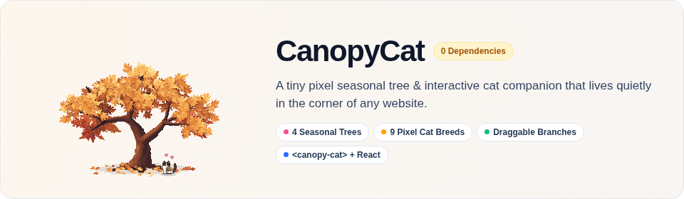
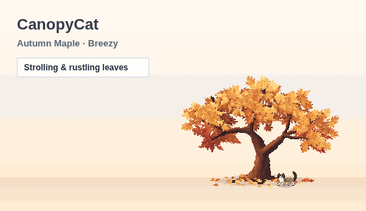
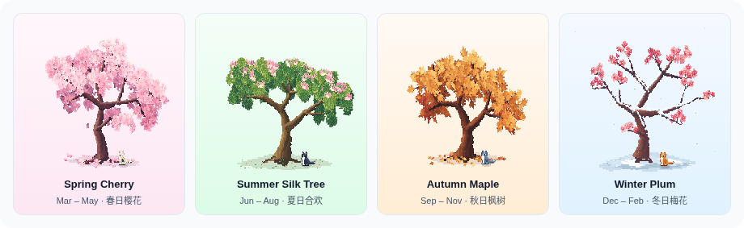
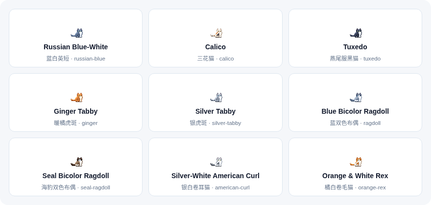

<div align="center">



<p>
  <a href="./README.md">English</a> · <strong>简体中文</strong>
</p>

<p>
  <a href="https://liuxsh9.github.io/canopy-cat/"></a>
  <a href="https://github.com/liuxsh9/canopy-cat/releases"></a>
  
  
  <a href="./LICENSE"></a>
</p>

<p>
  零依赖、轻量级的四季像素树与互动小猫网页伴侣，静静陪在任意网页的角落。<br />
  只需一行 <code>&lt;canopy-cat&gt;</code> 标签，即可放进你的博客、文档站、个人主页或 Web 应用。
</p>



<br />
<sub><em>点击小猫抚摸 · 拖拽树枝晃落枝叶 · 点击树干打开设置面板切换四季、花色与天气</em></sub>

</div>

---

## 项目亮点

- **零运行时依赖**：纯 HTML5 Canvas 与程序化像素绘制，压缩后仅约 35 kB。
- **四棵手绘四季树**：春樱、夏合欢、秋枫、冬梅自由切换，各自拥有独立的枝叶、花瓣、绒絮或飘雪积雪细节。
- **9 款手绘像素猫**：26 帧 `30×26` 动作图集，与任意季节树自由混搭，默认 `cat="auto"` 按树种自动推荐高对比度配色。
- **生动而不打扰的常驻节律**：约 88% 时间静静趴睡、揣手或打盹，动作带防重复冷却；离开视口、切后台或开启系统「减弱动态效果」时自动暂停，几乎零负担。
- **丰富的微交互彩蛋**：
  - **摸摸猫**：点击小猫冒出像素爱心（`♥`）并露出开心表情。
  - **拽树枝**：真实弹簧骨骼物理，拽动摇晃枝叶；会惊醒熟睡的小猫（`!`），或吸引清醒的小猫好奇爬树。
  - **暴风避雨**：切换到风暴天气时，小猫会优雅小跑离场躲雨，等风停放晴后自己踱步回来。
  - **日常小动作**：先舔手再洗脸的 4 帧洗脸循环、抱树干当猫抓板（木屑飞溅 + 树干微震）、追逐飘落的花叶、三档踩落叶物理扰动。
- **全框架通用**：内置 Shadow DOM 样式隔离的 `<canopy-cat>` Web Component、原生 JS/TS API，以及可选 React 封装（`canopy-cat/react`）。

---

## 四棵四季树

<div align="center">
  
</div>

| 标识 | 树种 | 随树推荐猫 | 特色细节 |
| --- | --- | --- | --- |
| `cherry` | 春日樱花 | 三花猫 | 飘落樱花瓣 |
| `silk` | 夏日合欢 | 燕尾服黑猫 | 随风轻舞的绒花絮 |
| `maple` | 秋日枫树 *（默认）* | 蓝白英短 | 多层金红枫叶飘落 |
| `plum` | 冬日梅花 | 暖橘虎斑 | 飘雪与枝头积雪分层（不遮挡枝头小猫） |

---

## 九款像素小猫

<div align="center">
  
</div>

默认 `cat="auto"` 自动按季节树推荐配色，也可以传 `cat="none"` 仅展示树木，或直接指定任意花色：
`russian-blue`（蓝白英短）· `calico`（三花猫）· `tuxedo`（燕尾服黑猫）· `ginger`（暖橘虎斑）· `silver-tabby`（银虎斑）· `ragdoll`（蓝双色布偶）· `seal-ragdoll`（海豹双色布偶）· `american-curl`（银白卷耳猫）· `orange-rex`（橘白卷毛猫）。

---

## Windows 桌面宠物

从 [GitHub Releases](https://github.com/liuxsh9/canopy-cat/releases) 下载 `CanopyCat-windows-x64.exe` 并双击运行。便携版使用 WebView2，Windows 11 自带，Windows 10 可补装运行时。[WebView2 下载](https://developer.microsoft.com/microsoft-edge/webview2/)

拖动树干底部可以移动宠物，拖树枝可以摇树，点击猫可以抚摸。右键点击系统托盘里的猫咪图标，可以显示或隐藏宠物、切换置顶、调整大小和重置位置，也可更换四季树、猫咪花色和天气。桌面版默认使用海豹双色布偶（`seal-ragdoll`）。开启「鼠标穿透」后，整个宠物窗口会把点击交给下方窗口，从托盘菜单可恢复互动。

在 Windows x64 上安装 [Tauri 构建依赖](https://v2.tauri.app/start/prerequisites/)，依次运行 `npm ci` 和 `npm run build:desktop`。EXE 输出到 `desktop/src-tauri/target/x86_64-pc-windows-msvc/release/canopy-cat.exe`。本地开发可运行 `npm run dev:desktop`。

---

## 快速上手

### 1. 一行 HTML 嵌入（最适合个人博客 / Hexo / Hugo / VitePress / 静态页）

```html
<script type="module" src="https://liuxsh9.github.io/canopy-cat/canopy-cat.js"></script>
<canopy-cat tree="maple" cat="auto" weather="breezy" lang="zh"></canopy-cat>
```

### 2. 原生 JS / TypeScript（Vue、Svelte、Astro 等任意前端项目）

```bash
npm install https://github.com/liuxsh9/canopy-cat/releases/latest/download/canopy-cat.tgz
```

```js
import { mountCanopyCat } from 'canopy-cat';

const companion = mountCanopyCat(document.body, {
  tree: 'maple',      // 'cherry' | 'silk' | 'maple' | 'plum'
  cat: 'auto',        // 'auto' | 'none' | 任意花色 key
  weather: 'breezy',  // 'calm' | 'breezy' | 'storm'
  lang: 'zh',
  position: 'bottom-right',
  persist: true,      // 在 localStorage 记住访客自己的偏好设置
});

// 也支持代码主动触发动作：
companion.triggerAction('pet');     // 'pet' | 'scratch' | 'climb' | 'groom' | 'nap' | 'stretch' | 'stroll'
companion.poke();                   // 轻晃一下树枝
companion.regrow();                 // 让枝叶重新长回
```

### 3. React 项目

```jsx
import { CanopyCat } from 'canopy-cat/react';

export function App() {
  return <CanopyCat tree="maple" cat="auto" weather="breezy" lang="zh" persist />;
}
```

<details>
<summary><strong>配置项速查</strong></summary>

| JS 参数 | HTML 属性 | 默认值 | 可选值 |
| --- | --- | --- | --- |
| `tree` | `tree` | `'maple'` | `'cherry'`, `'silk'`, `'maple'`, `'plum'` |
| `cat` | `cat` | `'auto'` | `'auto'`, `'none'`, `'russian-blue'`, `'calico'`, `'tuxedo'`, `'ginger'`, `'silver-tabby'`, `'ragdoll'`, `'seal-ragdoll'`, `'american-curl'`, `'orange-rex'` |
| `weather` | `weather` | `'breezy'` | `'calm'`, `'breezy'`, `'storm'` |
| `direction` | `wind-direction` | `'right'` | `'left'`, `'right'` |
| `speed` | `wind-speed` | `34` | `0` – `100` |
| `gusts` | `gusts` | `'light'` | `'off'`, `'light'`, `'strong'` |
| `size` | `size` | `150` | `50` – `200`（缩放百分比） |
| `growthSpeed` | `growth-speed` | `100` | `0` – `200` |
| `sheddingSpeed` | `shedding-speed` | `100` | `0` – `300` |
| `leafRetention` | `leaf-retention` | `50` | `0` – `100` |
| `controls` | `controls` | `true` | `true` / `false`（点击树木是否展开配置面板） |
| `position` | `position` | `'bottom-right'` | `'bottom-right'`, `'bottom-left'`, `'inline'` |
| `theme` | `theme` | `'auto'` | `'auto'`, `'light'`, `'dark'` |
| `lang` | `lang` | `'en'` | `'en'`, `'zh'` |
| `persist` | `persist` | `false` | `true` / `false`（是否本地持久化用户配置） |

</details>

---

## 本地开发

```bash
git clone https://github.com/liuxsh9/canopy-cat.git
cd canopy-cat
npm install
npm run dev     # 启动交互式 Playground
npm run build   # 构建 dist/ 组件库与 dist-demo/ 演示站
```

---

## 灵感与致谢

- 季节树的像素美学与物理摇曳灵感来自 [FeralUI 的 Pixel Play](https://feralui.dev/pixel-play)。
- 宣传图、演示动图和 `seal-ragdoll` 花色的原型来自作者自家的海豹双色布偶。

## 开源协议

[MIT](./LICENSE) © 2026 [liuxsh9](https://github.com/liuxsh9)
